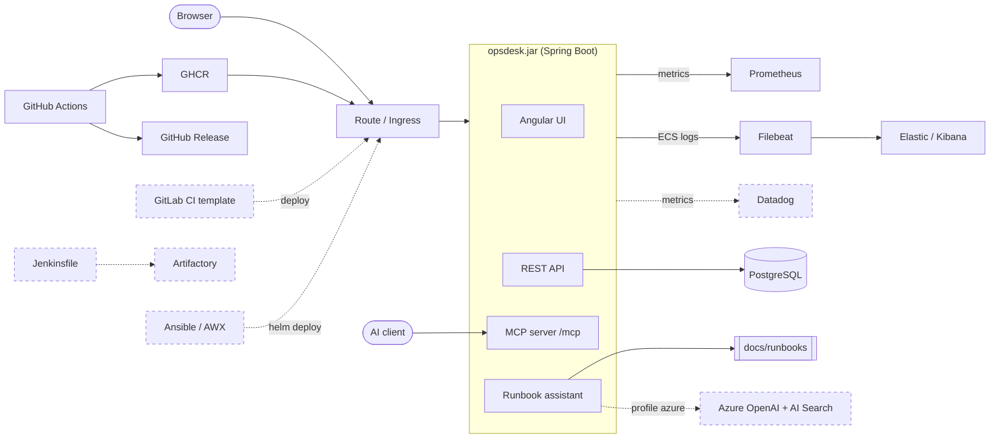

# opsdesk

[](https://github.com/donmatzos/opsdesk/actions/workflows/ci.yml) [](https://sonarcloud.io/summary/new_code?id=donmatzos_opsdesk) [](https://sonarcloud.io/summary/new_code?id=donmatzos_opsdesk)

A small **service-status and incident desk**: a Spring Boot (Java 25) backend and an Angular frontend in one jar, an MCP server for AI assistants, and a runbook assistant. It is built and operated like a production service: CI/CD, container, Helm for OpenShift, Terraform, observability and security scans.

Cloud parts (Azure OpenAI and AI Search, Datadog, OpenShift production, Artifactory, GitLab, Jenkins, Ansible Tower) are **mocked or switched off by default**, because the project runs without a cloud account. They are written the way they would be used, marked `MOCK:` in the code, and listed in [Mocks](#mocks).

## Live demo
<https://donmatzos.github.io/opsdesk/> runs the whole UI in your browser against simulated data (nothing leaves the page). It also hosts the [project guide](docs/guide/index.md): an architecture tour, what the project shows, the design and accessibility notes and a glossary with sources. The same Markdown is shown inside the app and on GitHub.

## Architecture

Dashed nodes are mocks. The tour in [docs/guide/architecture.md](docs/guide/architecture.md) follows a request through every box.

## What this shows
| Skill | Where | Real or mock |
|---|---|---|
| GitHub Actions | [`.github/workflows/`](.github/workflows) (build, scans, image, publish, deploy, release, Pages) | real |
| CI templating | [`ci/gitlab/`](ci/gitlab) shared template + variables-only consumer; reusable [`maven-verify.yml`](.github/workflows/maven-verify.yml) | GitLab mock, workflow real |
| Jenkins | [`ci/jenkins/Jenkinsfile`](ci/jenkins/Jenkinsfile) | mock (parsed in CI) |
| Docker | [`Dockerfile`](Dockerfile): multi-stage, non-root, arbitrary UID, read-only root verified | real |
| Kubernetes, OpenShift, Helm | [`deploy/helm/opsdesk`](deploy/helm/opsdesk), [`tools/kind-verify.sh`](tools/kind-verify.sh) | real chart; prod values mock |
| DevSecOps | gitleaks, Trivy, SonarCloud, Dependabot in [`ci.yml`](.github/workflows/ci.yml) | real |
| Observability | Micrometer + Prometheus, ECS logs + Elastic ([`tools/elastic-verify.sh`](tools/elastic-verify.sh)) | real; Datadog mock |
| Terraform | [`infra/terraform/`](infra/terraform): Datadog, Azure, AWX (fmt, validate, tflint in CI) | validate only |
| Ansible Tower / AWX | [`infra/ansible/`](infra/ansible) playbook, [`infra/terraform/awx/`](infra/terraform/awx) job templates | mock |
| Artifactory | Maven profile `artifactory` in [`pom.xml`](pom.xml) | mock |
| Releases | [`release.yml`](.github/workflows/release.yml), [`tools/release-check.sh`](tools/release-check.sh) | real (first tag pending) |
| Incident analysis | [`docs/runbooks/`](docs/runbooks), [`docs/postmortems/`](docs/postmortems) | real |
| Bash, Python | [`tools/`](tools): smoke tests, checks for context, docs, contrast, guide, templates | real |
| Java, Spring Boot, PostgreSQL, Flyway | [`backend/`](backend), [migrations](backend/src/main/resources/db/migration) | real |
| Maven multi-module | [`pom.xml`](pom.xml): `frontend`, `ai`, `backend` into one jar | real |
| Angular, TypeScript | [`frontend/`](frontend): dashboard, WCAG 2.2 AA checked in CI, theme toggle | real |
| TestNG, Mockito, Vitest | tests in every module, Testcontainers for PostgreSQL | real |
| MCP server | [`/mcp`](docs/context/mcp.md): 7 tools, bearer token, [`tools/mcp-verify.sh`](tools/mcp-verify.sh) | real |
| RAG | [`ai/`](ai): BM25 over the runbooks, grounded answers with sources | real; model is a mock |
| Azure OpenAI, Azure AI Search | adapters behind profile `azure`, tested against a fake server | mock |
| Agentic engineering | [`CLAUDE.md`](CLAUDE.md), [`.claude/skills/ops-check`](.claude/skills/ops-check/SKILL.md), [`apm.yml`](apm.yml) | real |

The long version, with explanations: [docs/guide/skills.md](docs/guide/skills.md).

## Mocks
Each mock is complete code that runs against a fake or is switched off. The column "Where" lists every path that carries the marker `MOCK:` (`tools/docs_check.py` keeps this table and the code in sync); the rules are in [docs/context/cloud-mocks.md](docs/context/cloud-mocks.md).

| Mock | Why | Where | How to switch on |
|---|---|---|---|
| Azure OpenAI and AI Search | no Azure account | `ai/`, `backend/src/main/java/at/donmatzos/opsdesk/runbook/`, `infra/terraform/azure/` | profile `azure` and six environment variables |
| Datadog | no Datadog account | `backend/pom.xml`, `backend/src/main/java/at/donmatzos/opsdesk/config/`, `backend/src/main/resources/application.yml`, `infra/terraform/datadog/` | profile `datadog` with the key from the environment; chart value `datadog.enabled` |
| OpenShift production | no cluster (the dev deploy is real, behind a flag) | `deploy/helm/opsdesk/` | repository variable `OPENSHIFT_DEPLOY=true` and cluster secrets |
| Artifactory | no instance; real artifacts go to GHCR and GitHub Releases | `pom.xml` | Maven profile `-Partifactory` |
| GitLab CI | no GitLab instance | `ci/gitlab/` | set the variables in a consumer pipeline |
| Jenkins | no Jenkins instance | `ci/jenkins/` | run the Jenkinsfile on a Jenkins with the listed plugins |
| Ansible Tower / AWX | no AWX instance | `infra/ansible/`, `infra/terraform/awx/` | create the job templates, then launch them |
| Validate-only CI jobs | no accounts to apply against | `.github/workflows/` | the `terraform` and `templates` jobs run on `main`; `apply` never runs |

## Quick start
```bash
cp deploy/compose/.env.example deploy/compose/.env        # then set the database password and the MCP token (names only in the template)
docker compose -f deploy/compose/compose.yml --profile app up -d --build --wait
tools/smoke-test.sh http://localhost:8080                  # UI and API on http://localhost:8080
```
Build and test everything with `./mvnw verify` (needs Docker for Testcontainers). Frontend only: `cd frontend && npx ng serve`. More commands: [`CLAUDE.md`](CLAUDE.md).

## Use it from Claude Code
The backend serves an MCP server at `/mcp` (7 tools: services, incidents, open and change incident, search runbooks). It needs a bearer token (`OPSDESK_MCP_TOKEN` in `deploy/compose/.env`, for example from `openssl rand -hex 32`):

```bash
set -a; . deploy/compose/.env; set +a
tools/mcp-verify.sh      # MCP Inspector check, prints MCP VERIFY PASS
claude                   # the repo's .mcp.json registers the server "opsdesk"; ask "which services are degraded?"
```
Details: [docs/context/mcp.md](docs/context/mcp.md).

## Ask the runbooks
```bash
curl -s localhost:8080/api/assist -H 'Content-Type: application/json' -d '{"question":"database connection refused"}'
```
`POST /api/assist` and the MCP tool `search_runbooks` return the best-matching runbook sections with sources. The answer text comes from a **mock** model (`"mock": true`) unless profile `azure` is set. **Not for real use as it is:** `/api/assist` has no authentication and no rate limit; close and/or throttle it before running it against real Azure services.

## Repo map
| Path | Content |
|---|---|
| `backend/`, `ai/`, `frontend/` | Spring Boot app, retrieval and answer code (plain Java), Angular app |
| `deploy/` | Helm chart, local compose stack, OpenShift setup notes |
| `infra/` | Terraform (Datadog, Azure, AWX) and the Ansible playbook |
| `ci/` | GitLab template and Jenkinsfile (mocked) |
| `docs/` | `guide/` (public guide), `runbooks/`, `postmortems/`, `context/` (for coding agents), `plans/`, `adr/` |
| `tools/` | scripts for smoke tests and for checking docs, templates, Helm, releases |

## Module boundaries
`ai` has no dependency on Spring or on the backend, and `backend` depends on `ai` and `frontend`. The retrieval and answer code could be split out as its own service behind the same `Retriever` and `LlmClient` interfaces without touching the REST or MCP layers; the project keeps one jar because that is the simplest thing to operate.
