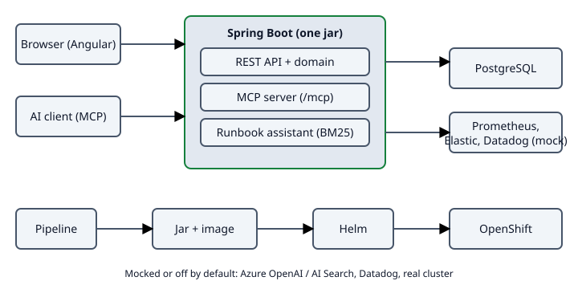

# Architecture tour

One jar, one container, one Helm chart. The tour follows a request from the browser down to the database, then sideways to the AI features and out to the pipeline and the cluster.

Text version of the diagram:
- Browser and AI client call the Spring Boot application.
- The application holds the REST API, the MCP server and the runbook assistant, and uses PostgreSQL.
- Metrics and logs leave the application towards Prometheus, Elastic and (mocked) Datadog.
- A pipeline builds the jar, scans it, builds the image and deploys it with Helm to OpenShift.

## 1. Browser and Angular
The [Angular app](../../frontend/src/app) is built into the jar, so one process serves UI and API. Standalone components, signals, no state library. A refresh on a deep link works because the backend forwards the known routes to `index.html` ([SpaForwardController](../../backend/src/main/java/at/donmatzos/opsdesk/config/SpaForwardController.java)).

## 2. REST API and domain
[Controllers](../../backend/src/main/java/at/donmatzos/opsdesk/incident) validate input and return RFC 9457 problem details. The domain rules (an incident only moves forward) live in the [Incident state](../../backend/src/main/java/at/donmatzos/opsdesk/incident/IncidentState.java), not in the UI.

## 3. PostgreSQL
Spring Data JDBC, schema changes as [Flyway migrations](../../backend/src/main/resources/db/migration). Tests run against a real PostgreSQL in a Testcontainers container, not an in-memory fake.

## 4. MCP server
An AI assistant such as Claude Code can look up services and work on incidents through the [MCP server](../context/mcp.md) at `/mcp`: stateless Streamable HTTP, bearer token, seven tools that call the same services as the REST API. [tools/mcp-verify.sh](../../tools/mcp-verify.sh) checks it end to end.

## 5. Runbook assistant (RAG)
`POST /api/assist` and the MCP tool `search_runbooks` search the [runbooks](../runbooks) with an in-memory BM25 index and answer with sources. If nothing matches, the answer says so and no model is called. The model behind it is a mock by default; the [Azure adapters](../../ai/src/main/java/at/donmatzos/opsdesk/ai) exist behind a Spring profile and are tested against a fake server only.

## 6. Build, scan, ship
[GitHub Actions](../../.github/workflows/ci.yml) builds and tests on every push, and on `main` also runs gitleaks, Trivy, Helm checks and Terraform checks, builds the [container image](../../Dockerfile) (non-root, arbitrary UID) and can deploy it. The [Helm chart](../../deploy/helm/opsdesk) targets OpenShift (Route, restricted security context, NetworkPolicy) and plain Kubernetes (Ingress).

## 7. Observe
Micrometer metrics at `/actuator/prometheus` on a separate management port, JSON logs with trace ids that Filebeat ships to a local Elastic stack, and [Terraform](../../infra/terraform/datadog) for Datadog monitors and a dashboard (validated in CI, never applied).

## 8. What is deliberately not here
No real cloud account, no authentication on the REST API (see the warning in the [README](../../README.md)), no Kubernetes operator. The goal is a service that is built and operated like a production one, small enough to read in an afternoon.
